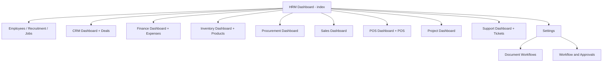

# S05 route families (graph summary)

231 routes group into: role dashboards (9) → module lists → add/edit detail pages, plus an applications suite (email/chat/calendar-class), support, assets, and a settings cluster containing the workflow pair. The machine-readable graph is `interaction-atlas/routes.jsonl` (547 rows across S04–S06) with `data/pages.jsonl` as the census. A Mermaid rendering of the S05 top level:

